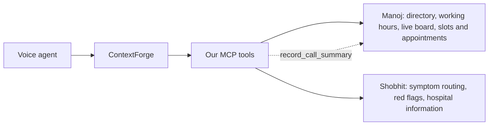

# MCP integration plan with confirmed service ownership

Status: source migration implemented; slots rules updated 9 October 2026. Slots documentation approval and deployment readiness are separate (gates below). Original plan published 1 October 2026. Start with [the handover README](README.md), [target-state boundaries](TARGET-STATE.md) and [the source audit](CURRENT-STATE.md). The 1 October clarification makes scoped Azure retirement a mandatory completion phase; no cloud deletion is performed by this plan update.

Current availability and booking rules are recorded in [DECISIONS.md SL1](../../DECISIONS.md#sl1--slot-aware-availability-and-booking-9-october-2026) and the [slots plan](implementation/SLOTS-PLAN.md). SL1 supersedes the earlier on-call callback rules in A12/A13; schema `2026-10-10.1` supersedes the slots-only version for the combined slots/contact-fallback release. Earlier migration history below is not release evidence.

Updated 30 September 2026 from the user's decisions, the [published Manoj contract](https://healthcare-contract-docs.icytree-6543aaa9.centralindia.azurecontainerapps.io/openapi.yaml), and the [Opus review](OPUS-REVIEW.md). This is the migration plan, including the actionable review recommendations and the user's callback-only UNKNOWN policy. It supersedes earlier ownership proposals, slot requirements and the direct platform-to-REST summary path. Retirement, rollback and acceptance requirements are included here; the historical investigation is source evidence, not an additional implementation checklist. This is an implementation plan, not a claim of verified production readiness.

Keep the repository and extract in place. Our deliverable is the MCP server and tools consuming Manoj's operational backend and Shobhit's knowledge base. No operational backend, scheduling engine, interpretation engine, knowledge retrieval engine or application database should remain in our production implementation.

The public interfaces are the only dependency on either owner's implementation: keep contract snapshots, client-side types/adapters, configuration and consumer tests; no owner server source, images, database access or local knowledge/operational engines. Each owner builds and hosts their service independently. See [TARGET-STATE.md](TARGET-STATE.md) for allowed repository contents and conversational-tool design requirements.

**Confirmed scope**

| Decision | Integration consequence |
|---|---|
| Slot reads consume Manoj's pinned 0.4.0 contract | Selected-doctor AVAILABILITY reads `/availability/{doctorId}/slots`; its `enabled` controls slot policy. The live board is today-only; future slots supplement usual schedules. Department AVAILABILITY uses cached `/capabilities`, never slot fan-out. WORKING_HOURS reads neither board nor slots. Capacity is owner data, never computed by MCP (SL1). |
| Patient suggests a preferred time; agent creates the appointment | CREATE/RESCHEDULE require the chosen time when slots are enabled; absence gives INVALID_REQUEST/ASK_WHICH_TIME and no write. Optional session is internal, never forwarded. Success remains NOTED; return the recorded slotTime and slotMoved facts, without promising a confirmed appointment (SL1). |
| Rich multilingual date interpretation, ambiguous-name handling and department synonyms will be developed as we proceed | Start with the existing department list, free-text doctor search and explicit calendar dates. No new interpretation endpoint is a prerequisite. Basic caller clarification is sufficient when the returned choices or date are unclear; do not copy the legacy interpretation engine. |
| Shobhit owns symptom routing, red-flag detection and hospital information | Consume explicit routing/emergency/approved-answer results from the knowledge service. Do not ask Manoj to implement clinical routing or retain the old lexical engine locally. |
| Call summaries need an MCP tool | The implemented `record_call_summary` tool uses `createCallSummary`. Route call finalization through MCP; do not require a separate direct REST writer in the voice platform. |
| Ordinary UNKNOWN means callback details and call summary only | UNKNOWN in the selected scope prevents appointment writes; CALLBACK_NOTED carries callback contact. No separate task or transfer is created. NOT_CONFIRMED with an open bookable block can permit a request. On-call AVAILABILITY instead follows confirmed usable evidence or returns handoff; single-doctor on-call WORKING_HOURS always returns handoff. See SL1 D-6–D-8. |

## Slots series status and pre-deployment gates (9 October 2026)

Phases 1a–4b were built and reviewed; phase 4b is accepted. Phase 5 updates these documents and
is complete only when their review is approved. The combined slots/contact-fallback release publishes schema `2026-10-10.1` (10 October supplement to SL1).
**Nothing in the slots series has been merged or deployed. Documentation completion is not deployment readiness.**

Every release gate below remains pending for this slots release:

1. Garima approves the pull request to `main` and separately authorises deployment.
2. Authorised live verification on Manoj's HTTPS synthetic tenant: the external write journey recording `slots_path`, open blocks on both journey dates, the negative UNKNOWN-today test and read gates.
3. Authorised live bench against the 0.30 s tool budget, including the extra on-call by-name read group.
4. Knowledge host and deployed-adapter credentials, followed by deployed-transport gates and release smoke against the canary.
5. ContextForge schema refresh to `2026-10-10.1` after the approved release.
6. Voice-team readiness for SL1's new fields and outcomes.
7. **LOG-1:** fastmcp installs its own console handler, bypassing the adapter's JSON logging and privacy rule. Handling is undecided and requires Garima's decision; this remains a separate pre-deployment gate. No resolution is proposed here.
8. **Pending:** Manoj confirms that a converted caller-ID number is acceptable as `callerMobile` and updates the contract wording "Only when the caller gave it during the call".
9. **Pending:** the voice platform and ContextForge owners confirm that `X-Caller-Number` is always the end caller's own number, never a trunk number or a placeholder for a withheld ID.

Open but **not deployment gates unless Garima says so**: Manoj G-13–G-15 (already designed around),
recorder strictness permanence, an optional test-setup remedy for the T-4 mechanism, and optional
4b-M1 review O-1. These are documented in SL1; none reopens the accepted phase 4b.

**What the published contract changes**

Current pin: [0.4.0-draft](contracts/manoj-openapi-20261007.yaml), SHA-256 `d3e93f45498fb86feeb5bb93c0adaba7cff47b48daa21ac810790b5483e96c80` (see [contract provenance](contracts/README.md)); the contract-change discussion below describes the historical 30 September 0.3.0 snapshot.

The Swagger page loads `./openapi.yaml`. The 30 September snapshot is [the historical contract](contracts/manoj-openapi-20260930.yaml), SHA-256 `b8f282718c2c45410dd0dd403369223b9cbe8dea045ee044207aa1e52ec2de78`. It identifies itself as `0.3.0-draft`, with 20 paths and 23 operations versus the earlier attachment's 16 paths and 19 operations. Pin the revision/hash during development; the version string alone does not distinguish these contracts.

The additions are `issueMachineToken`, `staffLogin`, `refreshStaffSession` and `staffLogout`, plus authentication schemas and server configuration. The operational request/response schemas have not acquired natural-language date/department interpretation inputs. No slot endpoint was added. The documented `/availability` is a per-session live board, distinct from a slot inventory; its presence in the spec does not establish a running backend implementation.

The server list now distinguishes:

- Azure **contract mock**, `https://healthcare-contract-mock.icytree-6543aaa9.centralindia.azurecontainerapps.io`, with **no `/api/v1` prefix**. It is listed first, so Swagger targets it by default.
- Local backend `http://localhost:8000/api/v1`.
- Local Prism example mock `http://localhost:4010`, also without `/api/v1`.
- A backend Azure hostname that remains a placeholder, with `/api/v1`.

The supplied documentation is reachable. No operational or mutation endpoint, credentials, backend readiness or production latency was tested. The mock's existence is useful for development, but is not evidence of stateful backend behavior.

For MCP machine authentication, use `POST /auth/token` relative to the configured API server, form-encoded `grant_type=client_credentials`, authenticating with HTTP Basic or body client credentials as documented. Scope is granted at client registration; the request's `scope` field is ignored. Cache the returned token using `expires_in`, refresh by obtaining another machine token, and keep credentials separate for Manoj and Shobhit. Staff login/refresh/logout must not become caller tools or be used to bypass missing machine permissions. Register only the required operational and call-summary permissions; the existing MCP client needs both appointments.write and calls.write.

Use the full configured base URL without legacy `/api/v1` stripping. Test construction of token and operation URLs for both backend and no-prefix mock. Maintain a persistent client and independent pool/timeouts for each service. Cache tokens per tenant/client/service, refresh before expiry with a safety margin, and allow only one concurrent refresh. On a genuine authentication rejection, invalidate and refresh once only if the remaining operation deadline permits; retries of mutations retain the same operation key and payload. Never request staff scopes to bypass a failure.

`/health` checks the MCP process. `/ready` checks local configuration and initialized components; do not perform a fresh token request or require an undocumented downstream `/ready` on every probe. Report each dependency's health separately using bounded background checks and agreed authenticated operations. Release smoke tests must still verify actual external reads; local readiness alone is not a release pass. A knowledge dependency failure affects only search_knowledge, without stopping MCP from returning accurate failure results or finalizing summaries through a working operational service.

**Tool calls and owner reads**

The current consumer interface is [VOICE-TEAM.md](../VOICE-TEAM.md). MCP publishes facts and wire
requirements; conversation design and tool selection belong to the calling application.

1. Availability and booking call only Manoj. search_knowledge makes one explicit knowledge request.
   reasonVerbatim is operational data forwarded without interpretation.
2. Directory reads resolve names and department IDs. Ambiguity returns structured choices; specialized
   phonetic, synonym and multilingual interpretation remains external service work.
3. Selected-doctor AVAILABILITY always reads slots alongside existing reads: today profile/board/slots
   for an ID, board/slots after name resolution; future profile/slots. Only today reads the board.
   `SlotPlan.enabled` decides applicability. WORKING_HOURS reads profiles only, with the existing
   known-on-call shortcut. Department AVAILABILITY reads cached capabilities but never slots;
   bounded profile batches remain concurrent within each batch and deadline-bound.
4. Owner status and MCP decision/reason stay separate. SL1 D-6/D-7 keep ordinary UNKNOWN callbacks
   within the selected scope; NOT_CONFIRMED can permit a request with open bookable blocks. D-8
   replaces on-call callbacks with confirmed usable evidence or HANDOFF_REQUIRED/ON_CALL_DOCTOR;
   CANCELLED remains unavailable. Unreadable slots/capabilities are failures, never unavailability.
5. AVAILABILITY requires today or strict future YYYY-MM-DD; WORKING_HOURS permits no date. CREATE
   requires a doctor; RESCHEDULE uses the verified appointment's doctor. With slots enabled the
   chosen time is required, otherwise INVALID_REQUEST/ASK_WHICH_TIME without a write. Optional
   session is checked locally and never forwarded. Successful writes remain NOTED and expose
   slotTime/slotMoved under SL1 K-7/D-3. Without slots, the existing mixed-choice and unknown-end
   handoff rules remain. LIST/CANCEL, trusted IDs, confirmation and uncertainty are unchanged.
6. Department results keep a capped, name-ordered set of eligible doctors. With slots enabled,
   matching doctors give DOCTORS_MATCHED and bookableFound=0 until selected-doctor slots are read;
   supplied ended sessions are not matches. Incomplete absence still gives handoff. totalMatches
   counts directory matches; complete records whether all were evaluated successfully. WORKING_HOURS
   keeps on-call facts within the cap and bookableFound=0: single on-call gives handoff, empty regular
   schedule callback, normal hours PRESENT_WORKING_HOURS. SL1 defines one-day and slot facts.

Callback metadata contains reason and summaryOutcome, no spoken wording or separate callback task.
Failed reads remain failures. No capacity, slots or clinical ranking is inferred. Facility timezone
controls dates and expiry; today's blocks close at their end. See SL1 for the rules and the slots
plan for exact precedence; earlier board-overlay and department-write proposals are historical.

**Current MCP tool surface**

| Tool | Consumer contract | Behaviour |
|---|---|---|
| `get_doctor_availability` | Manoj directory, profile, live board, slots and capabilities reads | Selected-doctor slot-aware availability; department matches before slot checking; WORKING_HOURS without board/slots. SL1 defines on-call and refusal rules. |
| `manage_booking` | Manoj create/list/cancel/reschedule operations | Slot-aware CREATE/RESCHEDULE validate the chosen time. Identity, truthful lifecycle status, uncertainty and owner write contracts remain unchanged. |
| `search_knowledge` | Shobhit interface, pending | Explicit symptom routing, emergency/desk escalation and hospital answers; provisional downstream contract still needs owner acceptance. |
| `record_call_summary` | `createCallSummary`, `POST /call-summaries` | LLM-callable through the same gateway bearer; no summary listing or staff tools. |

There are four MCP tools. Schema `2026-10-10.1` is published in the repository; gateway/voice discovery
refresh remains a release gate, not proof of deployment. Each appointment output includes nullable
slotTime and default-false slotMoved; LIST and CANCEL keep slotMoved false.

**Trusted caller identity and appointment access**

Keep patient contact separate from caller authorization. Create accepts the supplied patient name and contact mobile; those fields do not establish authority to view or change existing appointments. LIST, CANCEL and RESCHEDULE must derive `mobile`/`callerMobile` from authenticated, tenant-bound platform context at the agreed verification level. Remove the legacy model-visible LIST phone override; model fields cannot set caller headers, tenant, authorization basis or idempotency keys. Bind forwarded context to the actual call and isolate concurrent callers.

Normalize verified phone context using an explicitly configured supported country rule and validate the contract's ten-digit Mobile field. Do not strip arbitrary prefixes or take the last ten digits. A trusted SIP caller-number header alone is not universal proof of ownership; the platform and Manoj must agree what verification the authenticated MCP consumer is asserting. Web/WhatsApp integrations must supply their own authenticated channel context under that same policy.

For the initial release, absent verification, unsupported numbers and requests to manage an appointment under another person's number cannot trigger a lookup or mutation using a dictated substitute. Return a neutral identity-unavailable/not-found result as appropriate and use the established assistance flow; do not implement delegated-family authorization locally. This restriction does not prevent creating a request with an authorized patient's dictated contact information. Define broader family access with Manoj/platform separately. Minimize returned appointment details and never expose symptom text, other contacts or raw upstream errors merely to select an appointment. The UNKNOWN callback flow remains summary-only; its resolved callback contact (explicit number, otherwise converted caller header) is contact data, not authorization.

**Mutation identity, retries and response validation**

The platform supplies a trusted logical operation ID for each confirmed create/cancel/reschedule intent. MCP derives an opaque key of at most 64 characters bound to tenant, call, action and that operation ID (not target). Freeze the exact outgoing body for that intent; backend replay compares it against the same key. Repeated model/network attempts for one pending intent must reuse both. A body hash may detect changes, but must not silently mint a new operation after a lost response.

Corrections before dispatch can replace the pending payload. After a definite rejection, a corrected request is a new explicit intent. After possible commit/UNCERTAIN, reconcile the original operation before deciding whether a correction requires rescheduling, cancellation or a new request. Rephrasing a name/reason is not sufficient evidence that the caller intended another appointment. Keep operation context in the platform's call lifecycle, not a new MCP database. Missing trusted call/operation context refuses the mutation locally; do not rely on Manoj rejecting an optional idempotency key.

Use explicit consumer outcomes that distinguish validated success, definite validation/auth rejection, state conflict, idempotency conflict and uncertain write completion. The final envelope names are an MCP schema choice; do not change Manoj's statuses. Do not claim success for a malformed 2xx body, or definite failure after an ambiguous post-send timeout. A replay response describes the original write and may need current-state checking after later changes. A list-by-mobile is not guaranteed to identify a particular lost write uniquely.

Apply one total deadline covering pool wait, OAuth, all downstream calls and any retry. Remove the legacy unconditional timeout/504 retry. Permit at most one same-key retry within the remaining turn budget when the owner's replay semantics make it safe; otherwise return an uncertain or unavailable outcome promptly. Do not sleep through Retry-After during the voice turn or multiply retries across gateway/MCP/platform layers. Finalization retries outside the voice turn keep their original operation identity and fixed payload. Agree replay TTL, scope and atomic commit/result persistence with Manoj before claiming recovery guarantees.

Validate successes and errors at each service boundary. Preserve optional fields as unknown; map known error codes into minimal MCP outcomes, and keep raw error prose/PII out of model output and logs. Failure or malformed data is not an empty successful availability result. Correlate logs with opaque call/operation IDs and timing, not phone query strings, patient names, reasons or credentials.

**MCP tools mapped to downstream REST endpoints**

Paths below are relative to the configured service base URL. Manoj's documented backend uses `/api/v1`; the published Prism mock has no `/api/v1` prefix. Directory calls are conditional on the caller's input and known IDs. Profile, today's board and selected-doctor slots can run in parallel once the doctor/date are known. Profiles and department capabilities use the directory cache; board and slots stay fresh.

| MCP tool/action | Owner | REST endpoint | Purpose |
|---|---|---|---|
| `get_doctor_availability` — department lookup | Manoj | `GET /departments` (`listDepartments`) | Obtain department names, IDs and staffing state. |
| `get_doctor_availability` — doctor search | Manoj | `GET /doctors?query=...` and/or `department=...` (`searchDoctors`) | Find doctor records and IDs; optional gender filter where requested. Clarify multiple matches. |
| `get_doctor_availability` — doctor details | Manoj | `GET /doctors/{doctorId}` (`getDoctor`) | Read `usualSchedule` for working-hour sessions and requested profile information. |
| `get_doctor_availability` — live board | Manoj | `GET /availability?doctorId=...&date=...` or `GET /availability?department=...&date=...` (`getAvailability`) | Today only: attendance, delays, cancellations, unconfirmed/unknown state and expected timing. Exactly one target filter per call. |
| `get_doctor_availability`; `manage_booking` — selected-doctor schedule gate | Manoj | `GET /availability/{doctorId}/slots?date=...` (`getAvailabilitySlots`) | Read uncached blocks for the requested date; `enabled` decides whether slot rules apply. |
| `get_doctor_availability` — department AVAILABILITY only | Manoj | `GET /capabilities` (`getCapabilities`) | Cached facility capability; no per-doctor slots fan-out or startup/background process. |
| `manage_booking` — create | Manoj | `POST /appointments` (`createAppointment`) | Record patient details, required doctorId, visit date and preferred time (required when slots enabled). Success is NOTED with returned slotTime/slotMoved, not confirmation. |
| `manage_booking` — list | Manoj | `GET /appointments?mobile=...` (`findAppointments`) | Retrieve appointments for the authorized number; optional from/to/status filters. |
| `manage_booking` — cancel | Manoj | `POST /appointments/{appointmentId}/cancel` (`cancelAppointment`) | Cancel using trusted caller identity and the documented request fields. |
| `manage_booking` — reschedule | Manoj | `POST /appointments/{appointmentId}/reschedule` (`rescheduleAppointment`) | Change visit date and preferred time (required when slots enabled); no new doctor/department field. session is not sent upstream. |
| `search_knowledge` | Shobhit | Endpoint pending | Hospital information, symptom routing and red-flag decisions through Shobhit's service. |
| `record_call_summary` | Manoj | `POST /call-summaries` (`createCallSummary`) | Store the completed call's summary, with callId replay protection. |

Shared transport calls `POST /auth/token` (`issueMachineToken`) for Manoj machine credentials when a cached token needs obtaining/renewing; it is not another MCP tool and need not run on every tool call. Shobhit authentication remains separately configured according to his contract. `GET /availability` is today's board, distinct from the per-doctor slots endpoint. The slots series changes no owner write endpoint or scope and adds no MCP tool; there are still four.

**Call-summary tool contract (approved 4 October 2026)**

All four tools share gateway authentication; record_call_summary is LLM-called. Its eight arguments are
intent, outcome, summaryText, callerMobile, language, doctorId, appointmentId and transferredTo.
Whole-call summaryText is required, nonblank and at most 500 characters, sent unchanged. The advertised
schema cap is 500; the existing outer 2000 cap allows service-level INVALID_REQUEST for 501–2000.
There is no separate caller-name/date argument, text prefix, composition or truncation. Names, callback
details, symptoms and requested timing can be recorded in summaryText, which is never logged.
Resolved callback contact is the explicit callerMobile when supplied, otherwise the caller-header number
strictly converted to the configured 10-digit national format. Invalid explicit contact is rejected.
CALLBACK_NOTED requires a usable resolved contact and forbids appointment/transfer fields; ordinary
summaries may omit unusable contact. Summary contact never grants appointment authority and does not
require X-Caller-Verification.

Trusted X-Call-Id and timezone-aware X-Call-Started-At supply identity/timing; no duration is sent.
The owner deduplicates by call ID: verified 201 → SAVED; verified 200 for our call ID → ALREADY_SAVED,
regardless of differing payload. The first accepted summary is final. Both responses must parse.
Summaries send no Idempotency-Key. Other outcomes are INVALID_REQUEST (with field names), NOT_CONFIRMED
(uncertain/transient/malformed response), and NOT_SAVED (missing context or definite auth refusal).
Responses contain only outcome, plus fields for INVALID_REQUEST; diagnostics stay in safe logs.

One same-body retry after an unanswered send and 401-only auth refresh share the existing write
transport. A definite 403 is NOT_SAVED; uncertainty from a previous send takes precedence. Bookings
retain their header keys. Summary's own default 8-second deadline is not a 300 ms voice promise.
MCP has no persistence or queue; the application owns timing and eventual retry. Live validation needs
calls.write and a designated synthetic tenant. No staff summary reads are exposed.

**Shobhit integration requirements**

The provisional single-request knowledge contract needs answer, no-answer, clarification, approved department, desk and emergency outcomes. Service failure is separate. See knowledge_contract.py; the owner has not accepted this proposal. Scheduling requires no knowledge permission.

For symptom routing, carry the verbatim question argument and language, preserve approved department references and clarify their mapping to Manoj's tenant directory. Shobhit decides the route; Manoj supplies operational department identity and staffing truth. `hasConsultant=false` must still prevent a claim that a consultant is offered. Do not reinterpret a knowledge answer as an operational promise.

search_knowledge can return emergency or desk decisions from its owner. It is an explicit tool,
not a conversation monitor. Voice prompts, guardrails and application-level acceptance belong to the
voice team. No local classifier or hidden scheduling gate is part of MCP.

For hospital information, return approved speakable text, language and provenance, with explicit no-answer/clarification handling. No model-invented medical advice or translation of approved text is added in MCP. No knowledge service interface or live implementation was supplied in this turn.

**30 September contract validation (historical) and remaining engineering gaps**

The 30 September snapshot validation found four invalid component schemas caused by five unquoted inline descriptions containing commas (the current pin and overlay are documented separately in contract provenance above):

- `CallSummaryCreate.properties.doctorId` and `.appointmentId`, lines 1208–1209.
- `Error.properties.error.properties.message`, line 1235.
- `ClientCredentialsGrant.properties.scope`, line 1256.
- `LoginResponse.properties.role`, line 1278.

Quote these descriptions or use block scalars in a Manoj-owned revision. All 25 discovered inline typed examples passed schema/format validation, but that does not make the full document valid. The contract was not edited.

For development, prefer a corrected owner-published contract. If that is not yet available, use an explicitly labelled test-only overlay containing the five quoting corrections, with source and overlay hashes; leave the downloaded original unchanged. Do not add guessed endpoint semantics to that overlay. Mark behavior fixtures based on unconfirmed assumptions separately and run the same consumer assertions against Manoj's designated test tenant when available. Neither Prism examples nor a stateful stub proves the owner's authorization, replay, scheduling or performance behavior.

Other earlier engineering gaps remain: exactly-one doctor/department is prose-only; trusted caller authorization differs from dictated mobile; family/delegated access is unspecified; appointment replay retention/scope/current-state semantics need agreement; health/error/rate-limit contracts are incomplete. These should be tracked collectively, not asked as a batch of user questions. Slots are now integrated under SL1; richer interpretation remains deferred.

The user has resolved the earlier interpretation-interface question for current planning: use the department endpoint to obtain IDs, use free-text doctor search as supplied, and develop richer interpretation as we proceed. ISO dates, department IDs and free-text queries are not blockers or reasons to require a new endpoint. Track advanced language/ambiguity behavior as deferred work; the interim flow uses returned directory choices and confirmed explicit dates. The legacy backend's interpretation code is historical evidence, not a requirement to preserve it in the new integration.

**One-second response budget and measurement**

Distinguish tool dispatch-to-result (including gateway and downstreams) from speech-end-to-useful-audio. The provisional 70 ms adapter/transport plus 180 ms downstream budget targets about 250 ms for the tool portion. Merely returning a tool within 500 ms does not guarantee a one-second caller response. Apply [the model-facing tool and measurement requirements](TARGET-STATE.md); no extra LLM, embedding or local engine belongs in MCP.

Measure end of caller speech to first audible useful result at the caller. Filler acknowledgement is reported separately. Measure clarification turns separately from completed availability/appointment journeys. The target percentile and load must be agreed before performance acceptance; proposed initial target is p95 <=1,000 ms under declared supported load, with cold-start and failure rates reported rather than excluded silently.

| Stage | Provisional allocation |
|---|---:|
| Endpointing and residual STT | 150 ms |
| Model selects tool/arguments | 150 ms |
| Gateway, MCP orchestration and transport | 70 ms |
| Downstream critical path for the selected tool | 180 ms |
| Model produces useful answer | 180 ms |
| TTS start and media playout | 170 ms |
| Headroom | 100 ms |
| Total planning allocation | 1,000 ms |

These allocations are engineering hypotheses, not measurements or a proof obtained by adding stage percentiles. Derive an absolute tool deadline from the remaining turn budget, reserving response/TTS time, and measure the complete journey directly. Availability may require doctor search followed by parallel profile/board/slots reads as applicable, without a knowledge call. Known IDs and cached profiles remove directory hops; board and slots stay fresh. Garima accepted the additional on-call by-name read group on 8 October (SL1); live verification against the configured 0.30 s tool budget remains pending. CREATE uses caller confirmation and the shared slot-aware schedule gate; the voice platform owns its safety state before dispatch.

Cache tenant-bound department/profile data with bounded TTL and agreed invalidation; cache neither live-board truth across turns nor knowledge results across changed caller questions. Preserve persistent connections and warm OAuth tokens. Bound directory pagination and profile fan-out; show incomplete results explicitly rather than claim no match. Keep one model-facing availability invocation for the internal composition. Add an early latency spike as soon as the real service hosts exist, from the intended MCP region; if the downstream critical path cannot fit, discuss service placement or owner-provided aggregation then, not speculative aggregation endpoints now.

Measure p50/p95/p99 with cold/warm token, DNS/TLS, process/model state, English/Kannada/Hindi inputs and realistic concurrency. Trace call/turn/operation IDs through speech end, gateway/MCP spans, downstreams, model response and first audible result without logging patient data. Inject latency/errors in stubs to verify deadline behavior, then measure real Manoj/Shobhit/gateway/voice paths. Contract-mock timing is not production evidence. LLM-called summaries and their retries have a separate default 8-second deadline; their timing belongs to the voice application and is not part of the 300 ms scheduling promise.

**Updated development and retirement phases**

These are the original MCP migration/retirement phases, not the slots-series phases. Their
acceptance and Azure cleanup are not established by completing slots phase 5.

| Phase | Concrete implementation work | Exit gate |
|---|---|---|
| 1. Consumer contracts and boundaries | Pin the operational spec and quoting-only correction process; define the four MCP input/output envelopes, trusted call metadata, timezone, mutation identity and summary contract. Record Shobhit's pending interface separately. Carry forward the UNKNOWN callback decision. | Enough consumer contract detail for implementation tasks; advanced interpretation is not a prerequisite (slots now follow SL1). External assumptions labelled. |
| 2. Independent test foundation | Separate dev/test operational and knowledge stubs; MCP contract snapshots; backend-free runner/CI job. Operational fixtures cover directory, profiles, session board, appointment lifecycle, auth and summaries. Knowledge fixtures cover routing/answers/failure. Controlled clocks and commit-then-drop-response cases; no engines or PostgreSQL. Start real-host latency spike when hosts arrive. | Mandatory integration tests run without API source/virtualenv/database. Missing specs or accidentally skipped required suites fail. Provisional knowledge fixtures are not represented as an agreed production contract. |
| 3. MCP and platform integration | Adapt tools/config/server/prompts; independent clients/auth; identity guards and explicit knowledge selection; deadlines/replay; LLM-called whole-call summary. Update gateway discovery, tool access and context forwarding. Coordinate changing default CI/tests with repointing the adapter. | Four tool contracts verified through MCP HTTP and stub journeys; all four tools are accessible with gateway authentication; first accepted summary is final. |
| 4. External verification | Run the same consumer suite against designated owner test services; verify actual gateway schema refresh/header isolation, summary persistence, synthetic summary writes and real voice latency. | Agreed contracts/auth/caller verification and callback-summary workflow exercised; one-second metric measured under stated conditions. Safe degradation and no false success demonstrated. |
| 5. Cutover and complete source retirement | Canary compatible MCP/gateway/prompt versions, keep one appointment authority, verify required data handoff, remove all legacy source/tooling and update documentation. | Clean checkout installs/builds/tests/deploys MCP without the legacy API, its environment, PostgreSQL, migrations or seed/apply jobs. Rollback path verified. |
| 6. Azure retirement and closure | Refresh the [resource inventory](AZURE-RETIREMENT.md), resolve shared ownership/data retention, retire obsolete API apps/jobs/images/database assets/secrets/grants after cutover, and remove exclusively obsolete resource groups. Preserve or relocate required shared consumers before removing parent resources. | No unexplained old backend resources or active references remain; retained shared resources have an owner/purpose, retained data has an agreed disposition, MCP/voice smoke passes and residual cost is reviewed. Code removal alone is not completion. |

Keep any temporary legacy test profile explicitly named during migration. The new default tests must not silently skip contract coverage because `services/api` or the old OpenAPI disappeared. Add the new independent path before removing the old one; switch active CI and deployment in step with the adapted tools. Stubs must be dev/test-only, excluded from the production image, and must not be accepted as production downstream configuration.

**Prompt and gateway migration**

Maintain `prompt.py` and the healthcare pack around date-aware facts, clarification, CALLBACK_NOTED and truthful appointment states. Remove slotId/newSlotId, capacity/confirmation-code promises and obsolete timingCertainty/outcome branches. CONFIRMED_BY_DESK can be described as desk acknowledgement; it still does not mean a guaranteed time under Manoj's contract. Include explicit instructions for missing identity, routing failures and uncertain mutations.

Keep the four-tool discovery set and refresh gateway/voice schemas to `2026-10-10.1` after an approved release; handle SL1's new fields/outcomes. The implemented registration script checks names/input schemas only; output schemas require manual comparison through the voice virtual server against `make schema` after separately approved deployment. Verify the supported ContextForge refresh and access controls and refresh LiveKit's cached tool view together. Test concurrent-call header isolation and refusal of model-provided trusted fields. Production smoke checks auth, discovery, expected read-only results and appropriate dependency status; it must never create an appointment or summary just to pass a release check. Synthetic booking/summary tests run only against designated test tenants.

**Active repository retirement inventory**

| Disposition | Files/surfaces | Required result |
|---|---|---|
| Keep/adapt | `services/mcp/src/frontdesk_mcp/{tools,config,server,prompt,packs}.py`, `packs/healthcare.json`, CLI, pyproject/lockfile, Dockerfile and README | Standalone four-tool adapter with no backend imports, SQL stack, retrieval or interpretation engine. Preserve protocol/security/failure coverage while adapting semantics. |
| Adapt | `services/mcp/tests/test_tools_unit.py`, `test_e2e.py`, `test_deploy_smoke.py`, `services/mcp/tests/review/test_mcp_rest_integration.py`, conftest | Replace old x-mcp-tools, seeded slot and API-process/DB fixtures with mandatory MCP contracts and external-boundary fixtures. Keep identity/retry/transport test intent. |
| Adapt | `Makefile`, `scripts/{test,review-suite,demo,rollout-env}.sh`, `.github/workflows/ci.yml` | MCP-only default install/lint/build/test/demo; no API virtualenv, local DB, migration or seed requirement. Retain env parsing only for MCP-owned configuration. |
| Adapt | `deploy/docker-compose.yml`, `deploy/azure/{deploy.sh,smoke.py}`, `deploy/contextforge/register.py`, `.env.example` | Only MCP production deployment; two optional dev stub services; independent endpoint/credential settings; no API image/data-layer build, DB provisioning/jobs/waits or API virtualenv even for probe generation. |
| Hand over accepted data/requirements, then retire | API operational rules, approved directory/lexicon examples, operational journey tests | Manoj receives agreed behavior/data requirements where needed. No obligation to copy the old implementation and no migration of advanced interpretation into MCP. |
| Hand over accepted content/requirements, then retire | Legacy knowledge entries/fixtures, `api/services/knowledge.py`, `domain/knowledge.py`, `routers/knowledge.py` | Shobhit owns approved content, routing and retrieval. No hidden legacy knowledge fallback or local lexical index. |
| Retire entirely after replacement gates | All `services/api/`: source, tests, pyproject/lockfile, Dockerfile, Alembic config/revisions, migrations, seed/demo/rollout loaders, benchmarks, virtualenv/caches | No active operational API, scheduling/booking/identity ledger, staff routes, notification service, call-summary backend or knowledge engine in this repository. History remains in Git. |
| Retire | `scripts/local-pg.sh`, `deploy/postgres/init/01-roles.sh`, PostgreSQL/migrate/API/test-DB Compose services and active volume declarations | No local or CI database startup, DDL, seed or rollout-apply dependency. Source/config retirement does not delete existing data resources. |
| Adapt/retire | `rollouts/demo-hospital/*`, `rollouts/demo-hotel/*`, MCP hospitality pack | Convert useful synthetic hospital dialogues/data to consumer fixtures; retain MCP tenant settings only. Retire unsupported hospitality/slot examples from active paths; preserve history. |
| Adapt or mark historical | Root README/CLAUDE.md, architecture/decisions, handover docs, old `docs/frontdesk-api/{openapi.yaml,IMPLEMENTATION.md}` | External contract snapshots and our MCP schemas become active references. Old API/spec/ER/seed/review docs cannot remain active setup instructions or test dependencies. |
| Adapt/retire | `.claude/hooks/{session-start,ruff-on-edit}.sh`, `.claude/settings.json`, skills `{add-agent-tool,new-domain-pack,new-rollout}`, reviewers `{voice-safety-reviewer,latency-reviewer}` | No background API installation/migration, generation of backend routes or requirement to restore old slot/SQL behavior. |

Remove API-only dependency declarations/tooling such as Alembic, asyncpg, SQLAlchemy, FastAPI, indic-transliteration, metaphone and import-linter. Keep libraries actually needed by the MCP adapter or deliberately selected consumer tests, even if they were shared with the API. No runtime fallback or build/test import may reach the retired backend. Historical files may mention it; scan active source/scripts/docs rather than claiming every historical occurrence must disappear.

**Cutover, data and rollback**

Before retirement, identify whether the old deployment contains active appointments or approved content that owners must retain. If so, agree an owner-led data mapping/migration or legacy read-only desk access outside the new MCP runtime. Do not recast reserved slots as NOTED requests or assume identities map one-to-one. Inventory categories/resources/lexicon, schedules/board, bookings/history, notifications, replay ledger, summaries, knowledge entries and cache versions; transfer only what the respective owners accept. No data is changed by this plan update.

Pin a compatible MCP image, prompt/schema version, gateway registration and downstream contract revision for canary and rollback. Never dual-write appointments. Rollback normally restores a compatible prior MCP release against the same external ledger; if that cannot operate safely, disable affected writes and use the established assistance flow. Re-enabling the old API after new external appointments exist would create two authorities and is not an automatic rollback. Test this procedure before cutover.

Execute source removal and infrastructure decommission as distinct steps within this migration. The user requires obsolete Azure resources to be retired before declaring the work complete. The [read-only Azure inventory](AZURE-RETIREMENT.md) found legacy resources inside a shared resource group, environment, registry and PostgreSQL server. Prepare the exact scoped retirement list, resolve data/owner dependencies and complete cutover before destructive execution. Remove backend-only apps/jobs/images/database assets and access; delete whole groups/servers only when every remaining consumer is retired or relocated. Required shared infrastructure remains with explicit ownership. This planning update does not perform deletions or data changes.

**Acceptance checks for the revised plan**

| Area | Required checks |
|---|---|
| Hours and board | Full two-hour/multiple-session windows; morning IN/evening unconfirmed; LATE without double delay; cancellation; optional end/time fields; expiry with facility timezone; unconfirmed profile data; on-call and future dates. Owner slot facts, never invented capacity; SL1 on-call rules and WORKING_HOURS separation. |
| UNKNOWN callback | Ordinary UNKNOWN in scope collects name/number and saves CALLBACK_NOTED only, with no appointment, transfer, alternate booking, notification or task. On-call instead follows SL1 handoff; never treat a failed board request as successful UNKNOWN. |
| Basic lookup | Department IDs, free-text doctor search, multiple-choice clarification, explicit dates, pagination and unknown gender/language. Preserve incompleteness; advanced multilingual/synonym parsing is deferred. |
| Identity | Model phone/header/tenant override rejected; configured E.164 normalization; missing/unsupported verification; cross-number family access refused; concurrent calls/tenants isolated; patient/callback contact never reused as authorization. |
| Routing | Availability and booking make zero knowledge requests. search_knowledge makes one verbatim request. Voice-side tests prove every-turn emergency coverage, stale-result handling and write ordering. |
| Writes | Concurrent same-intent retry, changed payload, correction after definite rejection, uncertain commit, malformed success, replay after later mutation, missing call ID, 429/5xx/401 and total deadlines. Never uncertain write → success; never new key just because a response was lost. |
| Summaries | Same gateway access as all tools; trusted call/start headers; exact whole-call text within 500 characters, no composition or truncation; verified same-call 200 is ALREADY_SAVED even with changed payload; lost response uncertainty and language validation. Callback detail quality and disconnect recovery belong to the voice platform; no separate callback task. |
| Runtime/release | OAuth skew/single-flight/401 handling, mock/backend prefixes, local readiness plus separate dependency health, refreshed four-tool schemas/prompts, read-only production smoke, production cannot use development stubs. |
| Separation | Required tests pass in a clean environment without API source/virtualenv/PostgreSQL. MCP builds/deploys independently. Active scripts/hooks/docs no longer start or generate the backend. No hidden knowledge fallback. |
| Azure retirement | Mandatory phase 6: scoped removal of obsolete resources, shared-consumer preservation/relocation, data disposition, no obsolete active references, remaining-resource ownership and cost verification. |
| Performance and recovery | Real voice-to-result p50/p95/p99 at declared cold/warm/concurrent conditions; per-turn deadlines; filler excluded; summaries outside budget; compatible rollback against one appointment ledger. |

**Opus recommendation disposition**

| Review finding | Incorporated decision |
|---|---|
| OPUS-01 | Resolved by user: UNKNOWN → name/number, callback statement, summary only. The review's permissive UNKNOWN-booking alternative is not adopted. |
| OPUS-02 | Trusted authorization separated from patient contact; model phone override removed; normalization/verification and initial family limitation explicit. |
| OPUS-03 | Superseded by the user-approved 2 October decision: explicit knowledge tool, emergency guardrail in the voice platform, no scheduling gate. |
| OPUS-04 | Stable logical operation identity/frozen payload, distinct uncertain outcomes, validated responses and total-deadline retries. Body-hash-only deduplication is not adopted. |
| OPUS-05 | Superseded by user decision S1 (4 October): LLM-called whole-call summary, one gateway bearer, exact text and owner call-ID deduplication; disconnect handling remains outside this change. |
| OPUS-06 | One composed availability tool, provisional full response budget, early real-host spike and measured end-to-end distribution. |
| OPUS-07 | Independent OAuth clients, bounded refresh, full base URLs and local readiness with separate downstream status. |
| OPUS-08 | Facility timezone/clock, date-aware expiry, profile approval handling and no patientsPerHour allocation. |
| OPUS-09 | Explicit prompt rewrite, gateway/voice schema refresh and read-only production smoke. |
| OPUS-10 | Original spec preserved; any quoting-only test overlay labelled/hashed; stub assumptions separated from owner guarantees. |
| OPUS-11 | Retirement inventory, rollout/rollback, coordinated CI migration and corrected acceptance checks included in this current plan. |

External items still required before production claims: Shobhit's actual routing/answer/auth contract and outage handling; real Manoj host and caller-verification trust agreement; replay/missing-board semantics; approved treatment of profile data; verified gateway access controls; any necessary data handoff; and measured response target/percentile/load. Slots use the pinned contract; advanced interpretation remains deferred. Fixture checks do not establish release readiness; use the slots gates above. Questions are handled one at a time as the relevant dependency is reached.

No source implementation, deletion, deployment, database writes, operational API calls or communications to either team were performed. This revision updates planning documents only. Incorporating review recommendations is not a claim that the resulting implementation has already passed these checks, or that Opus has re-reviewed the revised plan.
